# BÁO CÁO BÀI TẬP THỰC HÀNH LẬP TRÌNH C# WINFORMS

## I. THÔNG TIN SINH VIÊN

* **Họ và tên:** Trần Thế Hào
* **Mã số sinh viên:** 24810320120
* **Lớp học phần:** Lập trình .NET - Mã Lớp: D19QTANM1

* **Link Repository:** [https://github.com/luny120/C-.NET-TranTheHao-23_10_26](https://github.com/luny120/C-.NET-TranTheHao-23_10_26/tree/main)

---

## II. DANH SÁCH BÀI TẬP HOÀN THÀNH & TỰ ĐÁNH GIÁ

| Bài tập | Tiêu đề bài tập | Trạng thái | Mức độ hoàn thành (%) |
| :---: | :--- | :---: | :---: |
| **Bài 1** | Quản lý Đặt phòng Khách sạn (Data Binding 2 chiều & ErrorProvider) | Hoàn thành | 100% |
| **Bài 2** | Quản lý Hồ sơ Nhân sự & Thông tin Lương (System Dialogs & File I/O) | Hoàn thành | 100% |
| **Bài 3** | Hệ thống MDI Quản lý Trường học & Đào tạo (Kiến trúc MDI) | Hoàn thành | 100% |
| **Bài 4** | Bảng điều khiển Tổng hợp Báo cáo Kho hàng (Async/Await & không khóa UI) | Hoàn thành | 100% |
| **Bài 5** | Mô phỏng Giám sát Cảnh báo IoT Real-time (Cross-thread Safety & Processing) | Hoàn thành | 100% |

---

## III. MINH HỌA GIAO DIỆN & KỸ THUẬT NỔI BẬT

### 1. Bài 1: Quản lý Đặt phòng Khách sạn

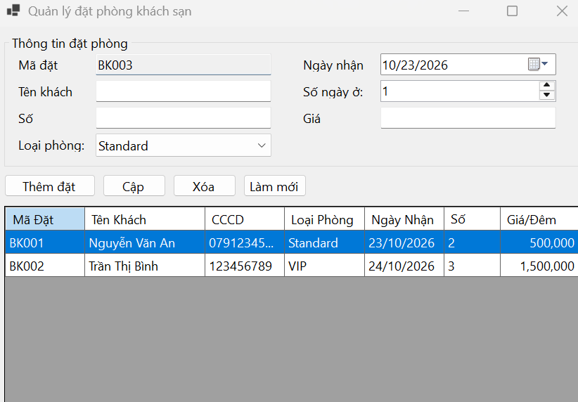

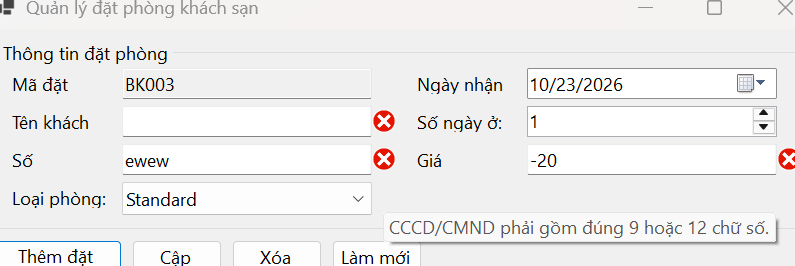

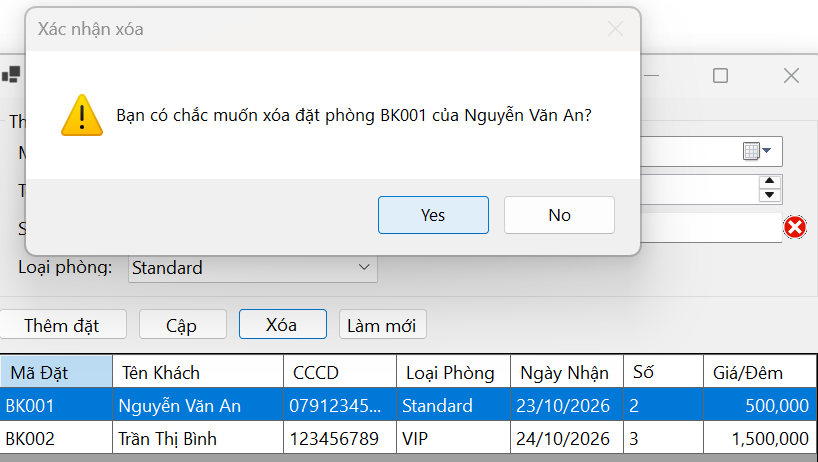

### 2. Bài 2: Quản lý Hồ sơ Nhân sự & Thông tin Lương

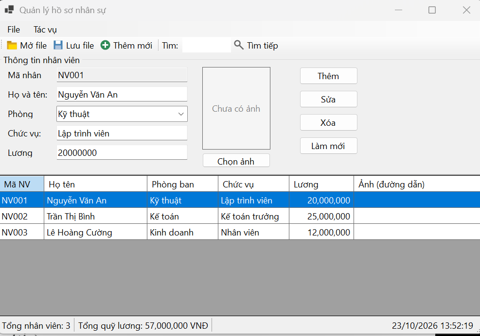

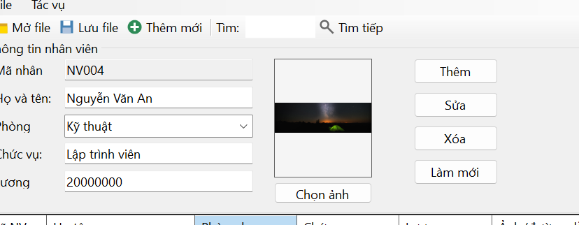

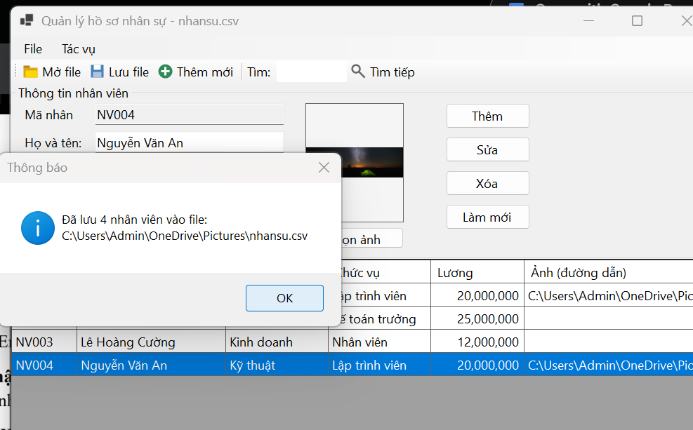

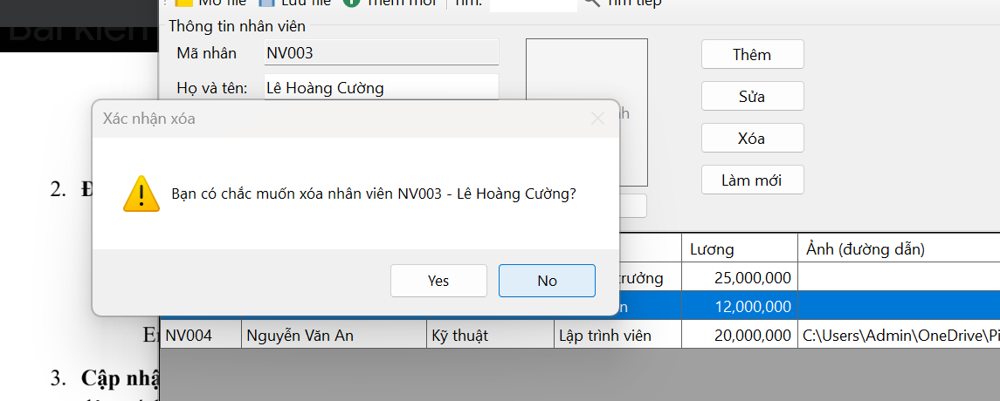

### 3. Bài 3: Hệ thống MDI Quản lý Trường học & Đào tạo

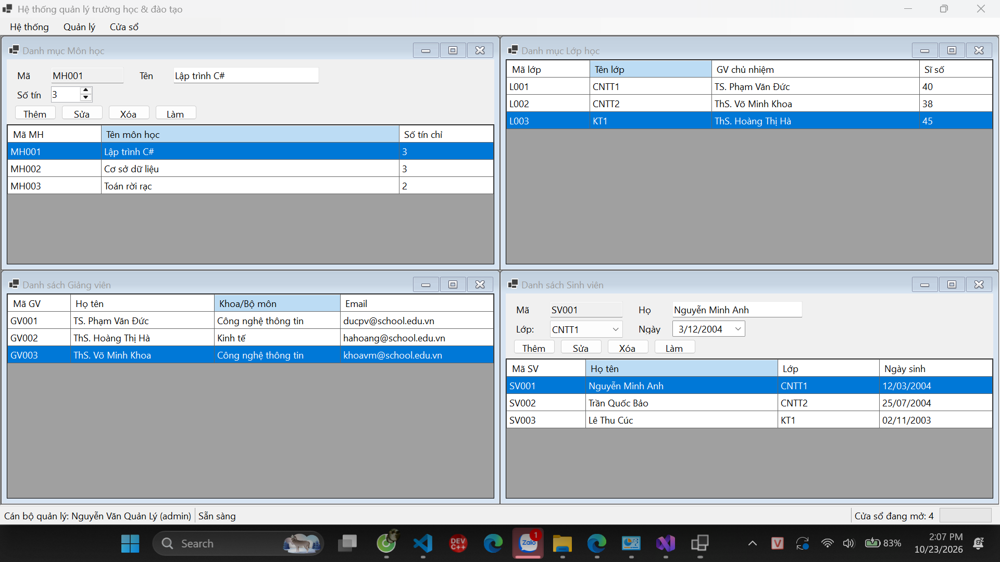

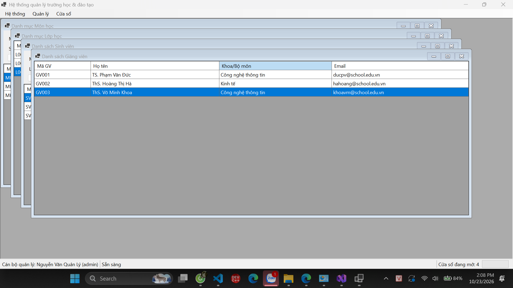

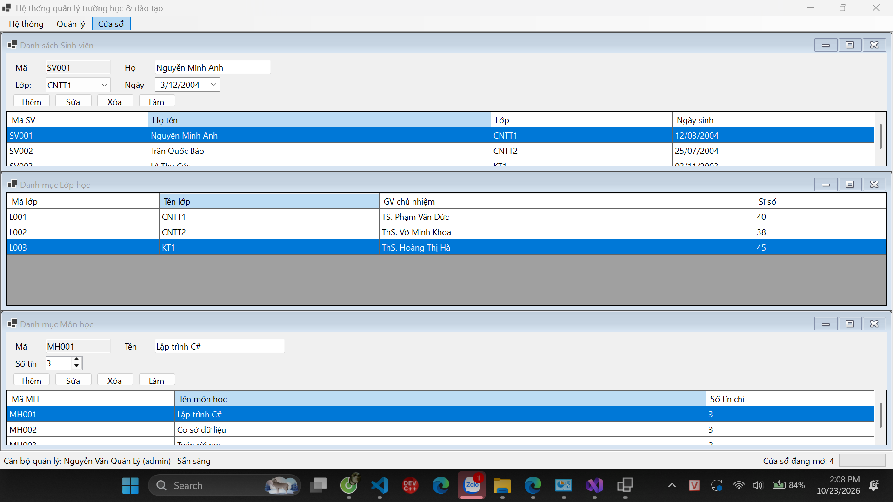

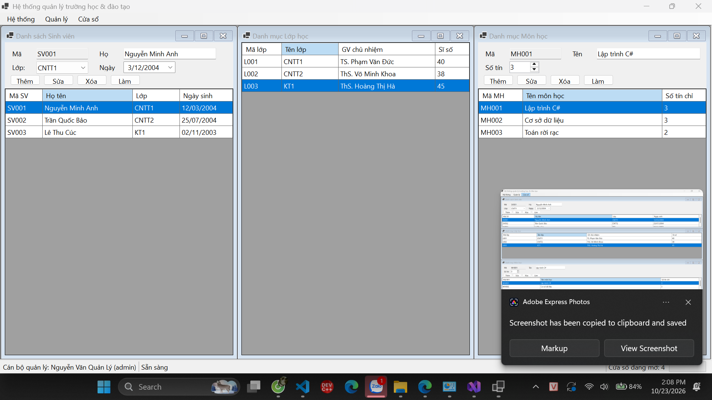

### 4. Bài 4: Bảng điều khiển Tổng hợp Báo cáo Kho hàng

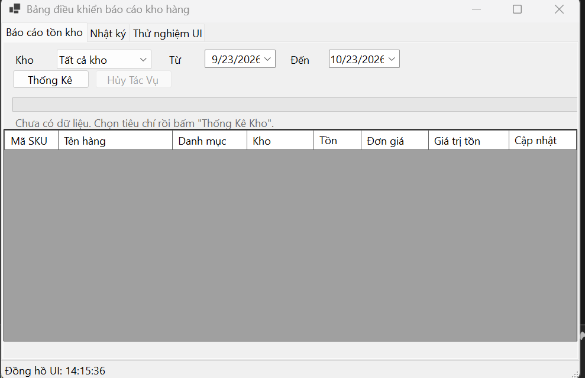

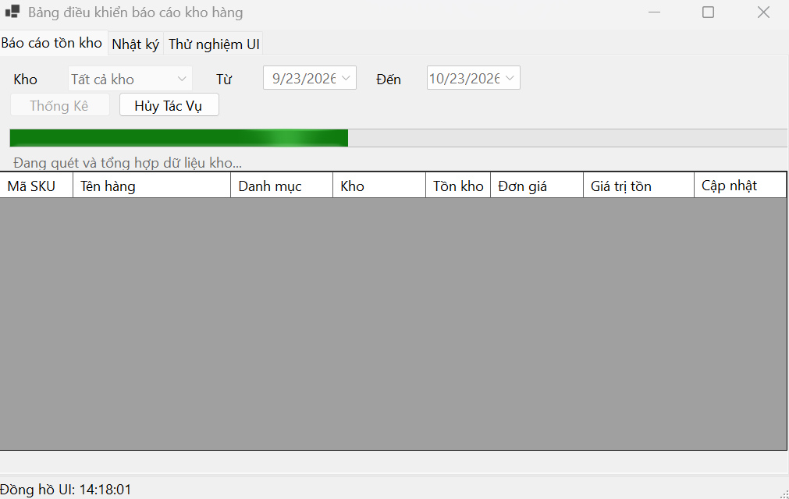

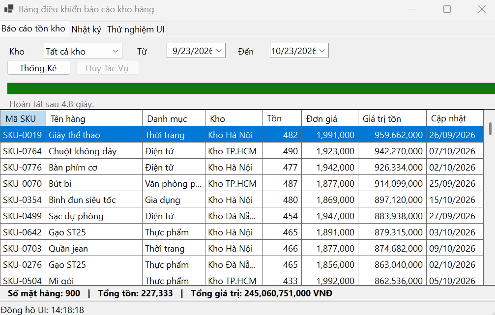

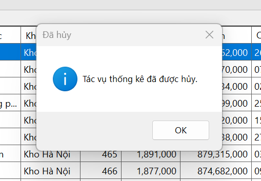

### 5. Bài 5: Mô phỏng Giám sát Cảnh báo IoT Real-time

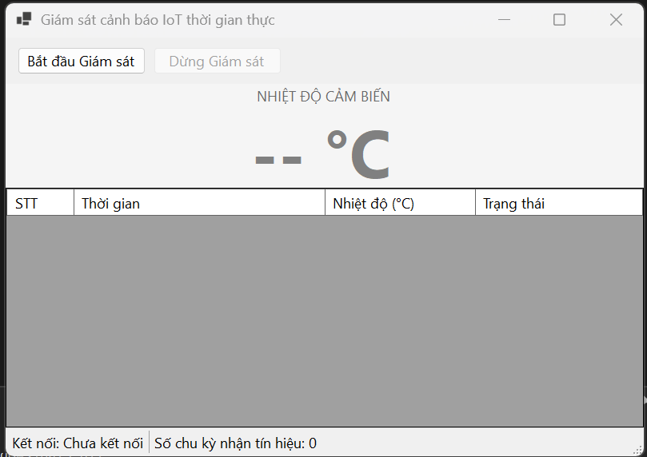

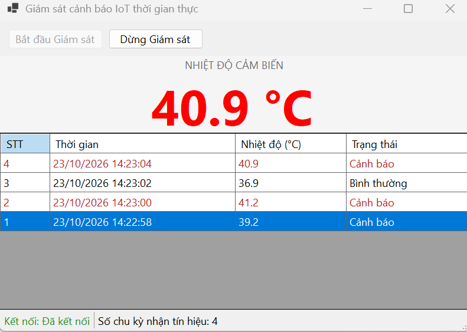

---

## IV. HƯỚNG DẪN CÀI ĐẶT & CHẠY DỰ ÁN

1. Clone Repository về máy:

```bash
git clone https://github.com/luny120/C-.NET-TranTheHao-23_10_26.git
```

2. Mở file solution `src/WinFormsAppSolution.sln` bằng Visual Studio 2022.
3. Chuột phải vào project cần chạy (ví dụ `Bai1`) > **Set as Startup Project**.
4. Bấm **F5** hoặc chọn **Start** để biên dịch và chạy chương trình.
